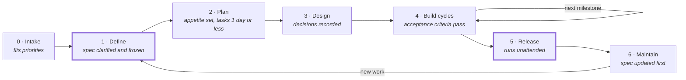

# Snowy Project Method

_Last updated: 2026-11-10 · Maintainer: [@sn0-y](https://github.com/sn0-y)_

## Contents

- [Purpose](#purpose)
- [Key terms](#key-terms)
- [What makes this method different](#what-makes-this-method-different)
- [Tracks](#tracks)
- [Phases at a glance](#phases-at-a-glance)
- [The phases](#the-phases)
- [Definition of Done and task rules](#definition-of-done-and-task-rules)
- [Blocker safeguards](#blocker-safeguards)
- [Working with AI](#working-with-ai)
- [Templates](#templates)
- [Sources](#sources)

## Purpose

Every project I start, personal or client, follows this one method from idea to maintenance. The order and exit criteria stay fixed; only the depth changes with project size.

**Principles**

- **The spec is the source of truth.** Requirements are written before code. If code and spec disagree, the code gets fixed, or the spec is changed first on purpose.
- **Fixed time, variable scope.** Every milestone has a time budget (an appetite). When time runs out, scope is cut; the deadline never moves.
- **One phase at a time.** A phase ends only when its gate is met.
- **Small, visible progress.** Work ships in short milestones, never one big drop.
- **New ideas go to the backlog.** They never enter the current milestone.
- **AI-readable by default.** Everything that defines a project lives as markdown in its repo, so any AI tool can read it without extra access.
- **Improve the method, not mid-project.** Changes to this doc happen at the retro.

## Key terms

| Term | Meaning |
| --- | --- |
| **EARS** (Easy Approach to Requirements Syntax) | A way of writing requirements in fixed sentence patterns, such as `WHEN <event> THE SYSTEM SHALL <response>`, instead of free text. Introduced in 2009 for safety-critical engineering; now used by AI coding tools because both people and AI read it the same way, and each sentence maps directly to a test. Patterns are listed under [Templates](#templates). |
| **Acceptance criterion** | One testable condition a feature must meet to count as done, written in EARS. |
| **Spec** | The written requirements for the project (`docs/requirements.md`, or `README.md` on Lite). |
| **Spec-driven development** | The spec, not the code, is the source of truth; AI builds and checks code against it. |
| **Clarify pass** | Asking an AI to find gaps, ambiguities and conflicts in the spec before it is frozen. |
| **Appetite** | A fixed time budget for a milestone or project, set before work starts (from Basecamp's Shape Up method). |
| **Circuit breaker** | The rule that when the appetite runs out, scope is cut instead of the deadline moving. |
| **Cool-down** | A short break after a release for small fixes, tidying and planning, with no new features. |
| **ADR** (Architecture Decision Record) | A short file recording one important technical decision: the context, the options, the choice and its consequences. |
| **`/init`** | A Claude Code command that scans the codebase and generates a `CLAUDE.md` context file. |
| **`AGENTS.md`** | An open-standard context file that many AI coding tools read automatically. |

## What makes this method different

Each part merges an established practice with a newer one to cover the weakness of each.

| Established concept | Newer concept | Merged into this method |
| --- | --- | --- |
| SDLC phase gates (Waterfall) | Agile milestones | Gates only on scope and release; building happens in short, repeatable cycles |
| Software Requirements Specification (SRS) | Spec-driven development for AI agents | The mini-SRS is a living spec that AI implements and is checked against, not a document filed away |
| EARS requirement syntax (2009; see [Key terms](#key-terms)) | AI-generated tests and implementation | Every requirement is written as `WHEN … THE SYSTEM SHALL …`, so an AI can turn it directly into a test |
| Requirements review | AI "clarify" pass | Before scope freezes, an AI lists gaps, ambiguities and conflicts in the spec |
| Shape Up appetite and cool-down | Solo, AI-accelerated building | Milestones are time-boxed; a short cool-down follows each release |
| Architecture Decision Records (ADRs) | AI agent context files | Decisions are recorded as short files that agents must treat as binding |
| `README.md` conventions | `CLAUDE.md` via `/init`, and the `AGENTS.md` standard | One context file generated from the codebase, readable by any AI tool |

## Tracks

Both tracks run all 7 phases in the same order; the track only changes which deliverables each phase produces (listed under each phase below). Pick the track at Intake.

**Use Full if any of these is true; otherwise use Lite**

1. Someone else (a client or a community) depends on it.
2. It stores user data or handles permissions or moderation.
3. I expect more than 5 days of build work.

A Lite project that later meets one of these moves to Full at its next milestone.

| Track | Appetite | Paperwork limit (phases 0 to 3) | Client sign-offs |
| --- | --- | --- | --- |
| Lite | Whole project: 5 days or less | Under 1 hour | None |
| Full | Each milestone: 1 to 2 weeks | At most 1 day, excluding client wait time | After Define and after Release |

## Phases at a glance



A phase starts only after the previous gate passes; build repeats per milestone. New work returns to Define, because every change starts as a spec change. Second line in each box = gate to pass. Thick border = client sign-off gate (Full track).

## The phases

Each phase ends with a gate and a fixed list of deliverables. Deliverables are split by track where they differ.

### 0 · Intake

Decide whether the project is worth doing now, which track it takes, and how much time it deserves.

**Gate:** fits current priorities; otherwise it goes on an ideas list.

**Deliverables**

- Lite: `README.md` with 3 lines (problem, who it is for, why now), the track and the appetite
- Full: `docs/brief.md` from the brief template, with the track and the overall appetite

### 1 · Define

Write the spec: what v1 must do, written as testable acceptance criteria, and what it will not do. Before freezing, run an AI clarify pass and resolve what it finds.

**Steps**

1. Write the Musts (and, on Full, Shoulds and Coulds) as EARS acceptance criteria.
2. Write the Out of scope list.
3. Ask an AI: "Read the spec. List ambiguities, gaps, conflicting requirements and missing edge cases." Resolve each one.
4. Freeze the spec.

**Gate:** no open questions from the clarify pass; v1 scope frozen. Full track: the client signs off.

**Deliverables**

- Lite: Musts as EARS one-liners and an Out of scope list in `README.md`
- Full: `docs/requirements.md` (mini-SRS: FR/NFR IDs, EARS acceptance criteria, Must/Should/Could, out of scope) and the client's recorded sign-off

### 2 · Plan

Set an appetite for each milestone, then fit the work to it. Milestones carry Musts first; Shoulds and Coulds are the scope that gets cut if time runs out.

**Gate:** every milestone has an appetite; every task takes 1 day or less, is worded as verb + result, and names the requirement ID it serves.

**Deliverables**

- Lite: `docs/plan.md` with one milestone, its appetite and its tasks as a `- [ ]` checklist
- Full: `docs/plan.md` with 2 or more milestones, each with an appetite and `- [ ]` tasks, plus stack choices
- Optional (both): a GitHub Project board as a visual mirror; `docs/plan.md` stays the source of truth

### 3 · Design

Decide how it works before writing code: the components, the data and the interfaces. Record each significant decision so neither I nor an AI undoes it later without reason.

**Gate:** I can explain how it works in 2 minutes, and every hard-to-reverse decision has an ADR.

**Deliverables**

- Lite: a few bullet points in `README.md`; ADRs only for decisions that would be costly to reverse
- Full: `docs/design.md` (architecture sketch, data model, command/API list) and ADRs in `docs/decisions/`

### 4 · Build cycles

Build one milestone at a time within its appetite: implement one task at a time against its acceptance criteria, test, self-review against the Definition of Done, then merge.

**Circuit breaker:** if the appetite runs out, cut the remaining Coulds, then Shoulds, and ship what passes. Never extend the deadline; leftover work goes back through Plan.

**Gate:** every acceptance criterion in the milestone passes, and the milestone meets the Definition of Done.

**Deliverables (both tracks)**

- A working milestone merged to main
- Tests (or recorded manual checks) for each acceptance criterion in the milestone
- Completed tasks ticked in `docs/plan.md`
- First milestone only: run `/init` in Claude Code once there is code, to generate `CLAUDE.md`

### 5 · Release

Move the finished build into production so it runs without me watching it. Then take a short cool-down before the next milestone.

**Cool-down:** 1 to 2 days with no new features: fix small bugs, tidy code, update docs, and plan the next milestone.

**Gate:** runs in production unattended. Full track: the client signs off.

**Deliverables**

- Lite: deployed on Dokploy, with a version tag
- Full: deployed on Dokploy, version tag, `CHANGELOG.md`, handover notes and the client's recorded sign-off

### 6 · Maintain

Keep it running and feed new work back through the spec. Bugs and requests never go straight into code.

**Change rule:** update the spec (new or changed acceptance criteria), then the plan, then the code.

**Gate:** each change is reflected in the spec before it is built; retro done. New work re-enters at Phase 1.

**Deliverables**

- Lite: new work added to the Backlog in `docs/plan.md` (bug reports can stay as GitHub issues, linked from there)
- Full: the same, plus a written retro in `docs/retro.md`

## Definition of Done and task rules

A milestone is done when every box below is ticked, nothing more.

**Definition of Done (per milestone)**

- [ ] Every acceptance criterion in the milestone passes (test or recorded manual check)
- [ ] No known errors in logs during a normal run
- [ ] Code merged to main, with readable commit messages
- [ ] README / changelog updated for anything user-facing
- [ ] Spec, `docs/plan.md`, ADRs and `CLAUDE.md` still match the code

**Task rules**

- A task fits in 1 day or less; bigger tasks get split.
- A task starts with a verb, names its result and the requirement it serves ("Add /ticket close command (FR-03)").
- Each task belongs to exactly one milestone in `docs/plan.md`.
- Ideas that appear mid-build go straight to the backlog.

## Blocker safeguards

Each common blocker has a rule already built into the method.

| Blocker | Safeguard | Where it lives |
| --- | --- | --- |
| Unclear tasks | 1-day task rule, verb + result + requirement ID | Phase 2, task rules |
| Unclear requirements | EARS acceptance criteria and the AI clarify pass | Phase 1 |
| Perfectionism | Fixed appetite with a circuit breaker; a fixed Definition of Done | Phase 4, Definition of Done |
| Boredom / low motivation | Short time-boxed milestones with visible, working output | Phases 2 and 4 |
| Scope shifting | New ideas go to the backlog; changes go through the spec first | Principles, Phase 6 |
| Process drift | Method changes only at the retro | Phase 6 |

## Working with AI

Any AI tool gets full project context by reading the repo; nothing important lives only in an external app.

| File | What it gives the AI | Created in |
| --- | --- | --- |
| `README.md` | What the project is (Lite: also spec and design notes) | Phase 0 |
| `docs/brief.md` | Problem, audience, track, appetite (Full) | Phase 0 |
| `docs/requirements.md` | The spec: what v1 must and must not do, as testable criteria (Full) | Phase 1 |
| `docs/plan.md` | Milestones, appetites, tasks and progress | Phase 2 |
| `docs/design.md` | Architecture, data model, commands/API (Full) | Phase 3 |
| `docs/decisions/` | Why key choices were made; binding for agents | Phase 3 onward |
| `CLAUDE.md` | Codebase conventions, commands, pointers to the files above | Phase 4, via `/init` |

**How to use AI in each phase**

- Define: AI rewrites rough requirements into EARS and runs the clarify pass; I decide every answer.
- Plan and Design: AI drafts tasks and ADRs; I review them before they count.
- Build: AI implements one task at a time and writes tests from the acceptance criteria; I review every diff.
- Maintain: AI updates the spec first when a change is requested, then the plan and code.

**After running `/init`**, add these lines to `CLAUDE.md`:

```markdown
Follow PROJECT_METHOD.md. The spec is docs/requirements.md (Lite: README.md);
current work is in docs/plan.md. Accepted ADRs in docs/decisions/ are binding;
proposed ADRs are context only. Implement one task at a time against its
acceptance criteria. If code and spec disagree, stop and ask.
```

To make the repo readable by other AI tools too (Codex, Copilot, Cursor and others read `AGENTS.md`), move the shared content into `AGENTS.md` and put `@AGENTS.md` on the first line of `CLAUDE.md`.

## Templates

Copy these into each new repo's `docs/` folder.

**Project brief (Phase 0)** · `docs/brief.md`

```markdown
# <Project name>
Track: Lite | Full
Appetite: <e.g. 5 days, or 2 milestones of 2 weeks>
Problem: <what is broken or missing>
For: <who uses it>
Why now: <reason it is worth doing>
```

**Mini-SRS (Phase 1)** · `docs/requirements.md`

```markdown
# <Project name> - Requirements v1

## Must
### FR-01 <short name>
As a <user>, I want <goal>, so that <benefit>.
- WHEN <event> THE SYSTEM SHALL <response>
- IF <unwanted condition> THEN THE SYSTEM SHALL <response>

## Should
### FR-xx ...

## Could
### FR-xx ...

## Non-functional
- NFR-01 Performance: WHEN <load> THE SYSTEM SHALL <respond within X>
- NFR-02 Security: THE SYSTEM SHALL <rule>

## Out of scope (v1)
- ...

## Clarify log
- Q: <question the AI raised> → A: <decision>

## Sign-off (Full track)
Client: ____  Date: ____
```

EARS (Easy Approach to Requirements Syntax) patterns for acceptance criteria:

| Pattern | Use for | Form |
| --- | --- | --- |
| Ubiquitous | Always true | THE SYSTEM SHALL … |
| Event-driven | Something happens | WHEN … THE SYSTEM SHALL … |
| State-driven | While in a state | WHILE … THE SYSTEM SHALL … |
| Unwanted behaviour | Errors, bad input | IF … THEN THE SYSTEM SHALL … |
| Optional feature | Only when a feature exists | WHERE … THE SYSTEM SHALL … |

**Plan (Phase 2)** · `docs/plan.md`

```markdown
# <Project name> - Plan
Stack: <language, framework, database, hosting>

## Milestone 1: <name> (in progress) · Appetite: <e.g. 1 week>
- [ ] Add <verb + result> (FR-01)
- [ ] Add <verb + result> (FR-02)

## Milestone 2: <name> · Appetite: <...>
- [ ] ...

## Backlog
- <ideas and requests not yet scheduled>
```

**Decision record (Phase 3)** · `docs/decisions/ADR-001-<short-name>.md`

```markdown
# ADR-001: <decision in a few words>
Status: Proposed | Accepted | Superseded by ADR-xxx
Date: YYYY-MM-DD

## Context
<the situation and the problem>

## Options
1. <option> - <pro / con>
2. <option> - <pro / con>

## Decision
<what was chosen and why>

## Consequences
<what changes, good and bad>
```

## Sources

- [GitHub Spec Kit](https://github.com/github/spec-kit) - spec-driven development: constitution, specify, clarify, plan, tasks, implement
- [Kiro specs](https://kiro.dev/docs/specs/concepts) - requirements.md with EARS acceptance criteria, design.md, tasks.md
- [Shape Up, chapter 3: Set boundaries](https://basecamp.com/shapeup/1.2-chapter-03) - appetite, fixed time with variable scope
- [Coding agents love decision records (O'Reilly)](https://oreilly.com/radar/coding-agents-love-decision-records/) - ADRs as agent context
- [AGENTS.md](https://agents.md) - open standard for AI agent context files
